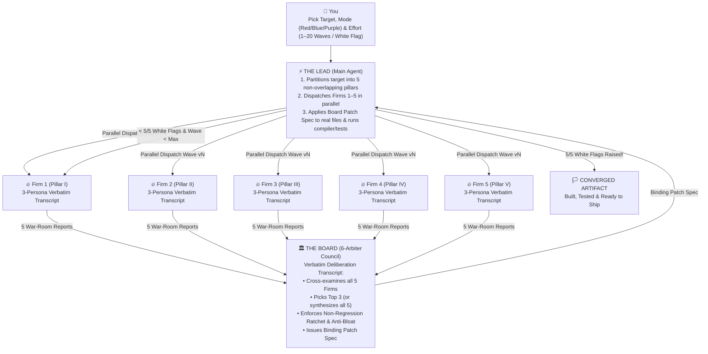

# 🏛️⚔️ THE BOARD (`the-board`)

> **"Perfection has a price. And that price is more tokens."**

Most agent skills are gimmicky and useless—glorified system prompts that tell your AI to *"think step by step"* and *"be super-duper thorough"* while producing the exact same mediocre output.

**This skill is definitely gimmicky. It is also brutally effective.** It was built for people who want unreasonable results and don't care if their token bill looks like a defense contractor's bar tab.

---

## 🎭 Why "Cringe" Roleplay Actually Works (The Philosophy)

Let’s address the elephant in the room: forcing AI subagents to roleplay named, ego-driven specialists arguing in a war room sounds cringe as hell on paper.

Why do it? **Because an LLM is made of text.**

When you ask a normal coding or reasoning agent to *"review my C++ kernel"*, *"find loopholes in this patent"*, or *"build a Go-To-Market plan"*, you activate its default RLHF customer-service mask. It wants to be polite. It wants to finish quickly. It gives you five lukewarm bullet points from the middle of the bell curve and clocks out.

Humans wear different masks when they do high-stakes work—and so do transformers. When you forbid summary bullets and force **5 parallel subagent teams (`Firms 1–5`)** to adopt hyper-specific, adversarial **Persona Masks** and write **400–800+ line verbatim war-room transcripts** (all **saved permanently to disk** in `.board/v1..vN/`), something emergent happens:

```
Standard Assistant Prompt  --->  Mean of RLHF Distribution (Polite, Lazy, Consensus-Seeking)
Persona War-Room Mask      --->  99.9th-Percentile Expert Tail (Ruthless, Technical, Self-Correcting)
```

1. **Emulating the People Who Actually Deliver**: In the training corpus, text written in the voice of a cynical 25-year kernel principal engineer, a `$2,400/hr` Federal Circuit litigator, or a former Pentagon acquisition shark is statistically bound to deep math, exact line citations, and zero tolerance for hand-waving. Wearing the mask forces the model to emulate the real humans who actually produce top-0.01% results.
2. **Internal Fistfights Before You Even See the Report**: Inside each Firm's saved transcript, **3 distinct personas** argue with *each other*:
   - **Mask 1 (The Ruthless Partner / Principal Lead)** demands catastrophic, quantifiable impact (`$`, crash, SLA breach, invalidity).
   - **Mask 2 (The Code / Math / Statutory Purist)** reads your file literally and **shoots down Mask 1's lazy first instinct** when your artifact already blocks it (*"Drop the ABA angle, Viktor—look at line 118, they already switched to a 64-bit Lamport sequence counter in Wave 2. Look at the consumer cancellation barrier instead..."*).
   - **Mask 3 (The Lateral Exploit / Design-Around Hacker)** turns the surviving second-order crack into a weaponized exploit or architecture.
3. **Every Verbatim Transcript Is Saved to Disk (`.board/v1..vN/`)**:
   - Every single word of dialogue from all 5 Firms (`vN/firm1_*.md` .. `vN/firm5_*.md`) and **The Board** (`vN/BOARD_ADJUDICATION_vN.md`) is written to disk on every wave.
   - Not only does this give the subagents permanent receipts across `v1 -> v16+` so they never repeat a dead attack, it lets you open the `.md` files and watch 5 rival syndicates lose their minds in Wave 14 when your Wave 13 patch welds shut their last loophole.

---

## ⚡ 10-Second Install (One `SKILL.md` Rules Them All)

Because **The Board** follows the open `SKILL.md` standard at the repository root (plus native plugin manifests for Claude Code, Antigravity, and Gemini CLI), you can drop it straight into whichever agent you drive:

### Option A: Clone Directly into Your Agent's Skills Folder
```bash
# Claude Code (Global Skill)
git clone https://github.com/Kemerd/the_board.git ~/.claude/skills/the-board

# Google Antigravity (agy) & Gemini CLI (Global Skill)
git clone https://github.com/Kemerd/the_board.git ~/.gemini/config/skills/the-board

# Any Project Workspace (Claude Code / Antigravity / Cursor / Codex)
git clone https://github.com/Kemerd/the_board.git .agents/skills/the-board
```

### Option B: Run the Installer (Installs Skill + `/board` Slash Command Everywhere)
```powershell
# Windows (PowerShell)
git clone https://github.com/Kemerd/the_board.git
pwsh -File .\the_board\scripts\install.ps1 -Target all
```
```bash
# macOS / Linux
git clone https://github.com/Kemerd/the_board.git
bash ./the_board/scripts/install.sh all
```

---

## 🏗️ How the War Room Operates



### Three Ways to Run The Board

| Mode | What Happens | Best For |
| :--- | :--- | :--- |
| **🔴 Red-Team Siege (`red`)** | 5 hostile syndicates try to break, exploit, or design around your artifact across waves `v1..vN` until `5/5` raise a verified **White Flag**. | Systems coding, concurrency, zero-day security audits, patent claims, M&A/commercial contracts |
| **🔵 Blue-Team Tournament (`blue`)** | 5 specialist boutiques compete to pitch the sharpest architecture or strategy. **The Board** grades all 5, crowns the **Top 3 Podium Winners**, and **The Lead** synthesizes them (plus tactical gems from #4 & #5) into a unified Master Playbook. | Go-To-Market (GTM) playbooks, Pentagon/DoD (`DIU/OTA/SBIR`) capture, greenfield system architecture |
| **🟣 Purple-Team Hybrid (`purple`)** | Blue Teams compete to build the architecture in Wave `v1`; Red Teams ruthlessly try to destroy the winner in Waves `v2..vN` until `5/5` White Flags. | Designing new cryptographic protocols, core kernels, or company-defining product specs from scratch |

---

## 🎚️ The Effort Dial (`v1` to `v20` / `White Flag`)

Tell the agent how hard you want to go:

| Effort Tier | Wave Cap | Stopping Condition | When to Pull It Out |
| :--- | :---: | :--- | :--- |
| **`strike`** | `1–2` waves | 1st- & 2nd-order flaws fixed; Top 3 Blue-Team designs merged | Fast PR reviews, bug root-cause isolation, tactical design docs |
| **`standard`** | `3–5` waves | 3rd- & 4th-order edge cases closed; `>= 95/100` Board rating | Production code refactors, API specs, commercial/DoD GTM playbooks |
| **`deep`** | `6–10` waves | 5th- to 10th-order paradigm shifts checkmated + Two-Tier anti-bloat pass | Lock-free/SIMD kernels, security boundaries, high-stakes contracts |
| **`relentless` / `white-flag`** | `10–20` waves | **Refuses to stop until `5/5` Firms raise a verified Formal White Flag (`0` surviving vectors)** | Crown-jewel patent filings (`v1 -> v16`), flight/medical/crypto software, existential bets |

---

## 🛡️ Built-In Safeguards (Why `v16` Doesn't Turn Into Spaghetti)

Iterating something 16 times with a naive prompt produces bloated, self-contradictory garbage. **The Board** enforces three hard engineering invariants across every wave:

1. **The Non-Regression Ratchet**: Every defense added in Wave `vN` is logged in `.board/CONVERGENCE_TRACKER.md`. No patch in Wave `v8` is permitted to break or weaken a defense established in Waves `v1–v7`.
2. **Two-Tier Compression (The Anti-Bloat Enforcer)**: Arbiter #3 on The Board is dedicated to killing bloat. Every 3 waves, verbose inline checks or sprawling legal definitions are factored into clean **Tier-2 helper modules / Specification Lexicons**, keeping your **Tier-1 hot-path code or independent claims** razor-sharp.
3. **Deterministic Verification Between Waves**: In codebases, **The Lead** runs the compiler, linter, and test suite after *every* wave. In legal/patent/strategy docs, **The Lead** runs cross-reference, numeral, and unit-economic consistency checks before starting the next wave.

---

## 🚀 Usage Examples

Once installed, trigger **The Board** naturally in chat or via `/board`:

### 1. Harden a C++ / Rust / TypeScript Module Until White Flag
```text
/board red white-flag src/engine/ring_buffer.hpp — Convene 5 systems/concurrency Red-Team firms and The Board. Run waves until 5/5 raise the white flag and all tests pass.
```

### 2. Run a Blue-Team Commercial + Pentagon/DoD Strategy Tournament
```text
Convene The Board in Blue-Team Tournament mode: have 5 specialist strategy firms pitch competing Commercial B2B and Pentagon/DoD (DIU CSO, SBIR, Production OTA) playbooks for our platform. Have The Board pick the Top 3 and synthesize the Master Playbook.
```

### 3. Red-Team a Patent Application or Commercial Contract Across 15+ Waves
```text
/board red relentless max=16 patent/specification.md — Run 5 competitor design-around & PTAB invalidity syndicates + The Board using the Two-Tier Lexicographer architecture until 5/5 White Flags.
```

---

## 📂 Repository Structure

```text
the_board/
├── SKILL.md                                    # Universal Agent Skill (Claude Code, Antigravity, Gemini CLI, Cursor, Codex)
├── README.md                                   # Documentation & quickstart
├── LICENSE                                     # MIT License
├── plugin.json                                 # Native Google Antigravity / Gemini plugin manifest
├── gemini-extension.json                       # Native Gemini CLI extension manifest
├── .claude-plugin/
│   └── plugin.json                             # Native Claude Code plugin manifest
├── commands/
│   └── board.md                                # `/board` slash command for Claude Code & Gemini CLI
├── references/
│   ├── persona_mask_theory.md                  # Why verbatim persona transcripts unlock 99.9th-percentile reasoning
│   ├── domain_playbooks.md                     # Ready-made 5-Firm + Board rosters (Coding, Security, Legal/IP, GTM/DoD, Research)
│   ├── prompt_templates.md                     # Copy-paste subagent dispatch templates for Waves v1..vN & The Board
│   └── effort_and_white_flag.md                # Effort Dial, Non-Regression Ratchet & White-Flag convergence rules
├── examples/
│   ├── coding_kernel_red_team_excerpt.md       # Real C++20 lock-free ring buffer Red-Team & Board Patch Spec excerpt
│   ├── legal_patent_red_team_excerpt.md        # Real Patent Design-Around -> Two-Tier Lexicon -> White-Flag excerpt
│   └── blue_team_gtm_tournament_excerpt.md     # Real 5-Firm Blue-Team DoD/B2B Tournament & Top-3 Podium synthesis excerpt
└── scripts/
    ├── init_board_workspace.py                 # Scaffolds `.board/v1/`, `board_config.json` & `CONVERGENCE_TRACKER.md`
    ├── verify_convergence.py                   # Deterministically audits transcript depth & 5/5 White-Flag convergence
    ├── install.ps1                             # Windows one-command installer (Claude Code + Antigravity + Gemini CLI)
    └── install.sh                              # macOS/Linux one-command installer
```

---

## 📜 License

MIT License — Created by **Donald Everett Hinton III**. Go build something unbeatable.
