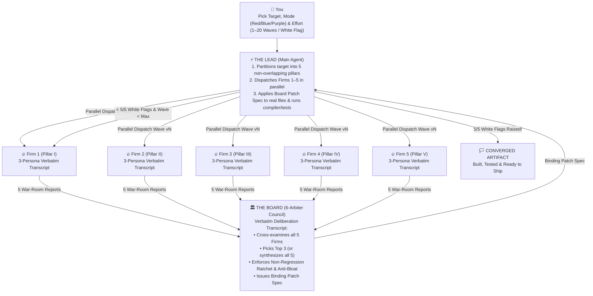

# 🏛️⚔️ THE BOARD (`the-board`)

**Stop asking one polite chatbot to "review your code" or "critique your plan." It’s lying to you to be nice.**

**The Board** is a universal multi-agent **Red-Team / Blue-Team / Board-of-Directors convergence skill** (`SKILL.md`) for **Claude Code**, **Google Antigravity (`agy`)**, **Gemini CLI**, **Cursor**, and **Codex**.

Instead of a single conflict-averse assistant giving you five lukewarm bullet points and calling it a day, **The Lead** (your main agent) splits your problem into **5 orthogonal pillars**, dispatches **5 parallel subagent syndicates (`Firms 1–5`)** wearing hyper-specific, ego-driven **Persona Masks** who argue in **400–800+ line verbatim war-room transcripts**, convenes **The Board of Directors** to adjudicate the carnage (picking the Top 3 or synthesizing all 5), and patches the real files across `v1 -> v2 -> ... -> v16+` until every adversary runs out of ammo and raises a verified **White Flag (`🏳️ 5/5`)**.

---

## ⚡ 10-Second Install (One `SKILL.md` Rules Them All)

Because **The Board** follows the open `SKILL.md` standard at the repository root (plus native plugin manifests for Claude Code, Antigravity, and Gemini CLI), you can drop it straight into whichever agent you drive:

### Option A: Clone Directly into Your Agent's Skills Folder
```bash
# Claude Code (Global Skill)
git clone https://github.com/Kemerd/the_board.git ~/.claude/skills/the-board

# Google Antigravity (agy) & Gemini CLI (Global Skill)
git clone https://github.com/Kemerd/the_board.git ~/.gemini/config/skills/the-board

# Any Project Workspace (Claude Code / Antigravity / Cursor / Codex)
git clone https://github.com/Kemerd/the_board.git .agents/skills/the-board
```

### Option B: Run the Installer (Installs Skill + `/board` Slash Command Everywhere)
```powershell
# Windows (PowerShell)
git clone https://github.com/Kemerd/the_board.git
pwsh -File .\the_board\scripts\install.ps1 -Target all
```
```bash
# macOS / Linux
git clone https://github.com/Kemerd/the_board.git
bash ./the_board/scripts/install.sh all
```

---

## 🧠 Why Verbatim Persona Roleplay Works ("The Mask Effect")

If you prompt an LLM with *"Find bugs in this lock-free ring buffer"* or *"Find loopholes in this patent claim,"* you trigger its RLHF-trained customer-service voice. It hedges. It skims. It gives you surface-level textbook advice and clocks out at 5:00 PM.

Something wild happens when you **forbid bullet summaries** and force 5 parallel subagents to write **verbatim war-room transcripts** between named, adversarial domain legends with clashing incentives:

```
Standard Assistant Prompt  --->  Mean of RLHF Distribution (Polite, Surface-Level, Consensus-Seeking)
Persona War-Room Mask      --->  99.9th-Percentile Expert Tail (Ruthless, Technical, Self-Correcting)
```

1. **Latent-Space Tail Conditioning**: In pre-training corpora, text written in the cadence of a cynical 25-year kernel architect, a `$2,400/hr` Federal Circuit litigator, or a former Pentagon acquisition executive is densely packed with exact line citations, weak-memory-model math, and statutory precision. The model *cannot* give a lazy answer without breaking character.
2. **Intra-Agent Dialectical Verification (The 3-Persona Triad)**: Inside every Firm's transcript, three distinct masks argue with *each other* before submitting their report:
   - **Mask 1 (The Ruthless Partner / Principal Lead)** demands catastrophic, quantifiable damage (`$`, crash, SLA breach, invalidity).
   - **Mask 2 (The Code / Math / Statutory Purist)** reads the target file literally and **shoots down Mask 1's lazy first instinct** when your artifact already defends against it (*"Drop the ABA angle, Viktor—look at line 118, they already switched to a 64-bit Lamport sequence counter in Wave 2. Look at the consumer cancellation barrier instead..."*).
   - **Mask 3 (The Lateral Exploit / Design-Around Hacker)** turns the surviving second-order crack into a weaponized exploit or design-around.
3. **Adversarial Ego Persistence Across Waves (`v1 -> v16+`)**: When **The Lead** patches Wave `v1` and messages the **exact same 5 subagent conversation IDs** in Wave `v2`, the personas take the patch personally. Their Wave 1 attack is dead, so they pivot to 2nd-, 5th-, and 12th-order paradigm shifts until every non-suicidal vector is mathematically or statutorily foreclosed.

---

## 🏗️ How the War Room Operates



### Three Ways to Run The Board

| Mode | What Happens | Best For |
| :--- | :--- | :--- |
| **🔴 Red-Team Siege (`red`)** | 5 hostile syndicates try to break, exploit, or design around your artifact across waves `v1..vN` until `5/5` raise a verified **White Flag**. | Systems coding, concurrency, zero-day security audits, patent claims, M&A/commercial contracts |
| **🔵 Blue-Team Tournament (`blue`)** | 5 specialist boutiques compete to pitch the sharpest architecture or strategy. **The Board** grades all 5, crowns the **Top 3 Podium Winners**, and **The Lead** synthesizes them (plus tactical gems from #4 & #5) into a unified Master Playbook. | Go-To-Market (GTM) playbooks, Pentagon/DoD (`DIU/OTA/SBIR`) capture, greenfield system architecture |
| **🟣 Purple-Team Hybrid (`purple`)** | Blue Teams compete to build the architecture in Wave `v1`; Red Teams ruthlessly try to destroy the winner in Waves `v2..vN` until `5/5` White Flags. | Designing new cryptographic protocols, core kernels, or company-defining product specs from scratch |

---

## 🎚️ The Effort Dial (`v1` to `v20` / `White Flag`)

Tell the agent how hard you want to go:

| Effort Tier | Wave Cap | Stopping Condition | When to Pull It Out |
| :--- | :---: | :--- | :--- |
| **`strike`** | `1–2` waves | 1st- & 2nd-order flaws fixed; Top 3 Blue-Team designs merged | Fast PR reviews, bug root-cause isolation, tactical design docs |
| **`standard`** | `3–5` waves | 3rd- & 4th-order edge cases closed; `>= 95/100` Board rating | Production code refactors, API specs, commercial/DoD GTM playbooks |
| **`deep`** | `6–10` waves | 5th- to 10th-order paradigm shifts checkmated + Two-Tier anti-bloat pass | Lock-free/SIMD kernels, security boundaries, high-stakes contracts |
| **`relentless` / `white-flag`** | `10–20` waves | **Refuses to stop until `5/5` Firms raise a verified Formal White Flag (`0` surviving vectors)** | Crown-jewel patent filings (`v1 -> v16`), flight/medical/crypto software, existential bets |

---

## 🛡️ Built-In Safeguards (Why `v16` Doesn't Turn Into Spaghetti)

Iterating something 16 times with a naive prompt produces bloated, self-contradictory garbage. **The Board** enforces three hard engineering invariants across every wave:

1. **The Non-Regression Ratchet**: Every defense added in Wave `vN` is logged in `.board/CONVERGENCE_TRACKER.md`. No patch in Wave `v8` is permitted to break or weaken a defense established in Waves `v1–v7`.
2. **Two-Tier Compression (The Anti-Bloat Enforcer)**: Arbiter #3 on The Board is dedicated to killing bloat. Every 3 waves, verbose inline checks or sprawling legal definitions are factored into clean **Tier-2 helper modules / Specification Lexicons**, keeping your **Tier-1 hot-path code or independent claims** razor-sharp.
3. **Deterministic Verification Between Waves**: In codebases, **The Lead** runs the compiler, linter, and test suite after *every* wave. In legal/patent/strategy docs, **The Lead** runs cross-reference, numeral, and unit-economic consistency checks before starting the next wave.

---

## 🚀 Usage Examples

Once installed, trigger **The Board** naturally in chat or via `/board`:

### 1. Harden a C++ / Rust / TypeScript Module Until White Flag
```text
/board red white-flag src/engine/ring_buffer.hpp — Convene 5 systems/concurrency Red-Team firms and The Board. Run waves until 5/5 raise the white flag and all tests pass.
```

### 2. Run a Blue-Team Commercial + Pentagon/DoD Strategy Tournament
```text
Convene The Board in Blue-Team Tournament mode: have 5 specialist strategy firms pitch competing Commercial B2B and Pentagon/DoD (DIU CSO, SBIR, Production OTA) playbooks for our platform. Have The Board pick the Top 3 and synthesize the Master Playbook.
```

### 3. Red-Team a Patent Application or Commercial Contract Across 15+ Waves
```text
/board red relentless max=16 patent/specification.md — Run 5 competitor design-around & PTAB invalidity syndicates + The Board using the Two-Tier Lexicographer architecture until 5/5 White Flags.
```

---

## 📂 Repository Structure

```text
the_board/
├── SKILL.md                                    # Universal Agent Skill (Claude Code, Antigravity, Gemini CLI, Cursor, Codex)
├── README.md                                   # Documentation & quickstart
├── LICENSE                                     # MIT License
├── plugin.json                                 # Native Google Antigravity / Gemini plugin manifest
├── gemini-extension.json                       # Native Gemini CLI extension manifest
├── .claude-plugin/
│   └── plugin.json                             # Native Claude Code plugin manifest
├── commands/
│   └── board.md                                # `/board` slash command for Claude Code & Gemini CLI
├── references/
│   ├── persona_mask_theory.md                  # Why verbatim persona transcripts unlock 99.9th-percentile reasoning
│   ├── domain_playbooks.md                     # Ready-made 5-Firm + Board rosters (Coding, Security, Legal/IP, GTM/DoD, Research)
│   ├── prompt_templates.md                     # Copy-paste subagent dispatch templates for Waves v1..vN & The Board
│   └── effort_and_white_flag.md                # Effort Dial, Non-Regression Ratchet & White-Flag convergence rules
├── examples/
│   ├── coding_kernel_red_team_excerpt.md       # Real C++20 lock-free ring buffer Red-Team & Board Patch Spec excerpt
│   ├── legal_patent_red_team_excerpt.md        # Real Patent Design-Around -> Two-Tier Lexicon -> White-Flag excerpt
│   └── blue_team_gtm_tournament_excerpt.md     # Real 5-Firm Blue-Team DoD/B2B Tournament & Top-3 Podium synthesis excerpt
└── scripts/
    ├── init_board_workspace.py                 # Scaffolds `.board/v1/`, `board_config.json` & `CONVERGENCE_TRACKER.md`
    ├── verify_convergence.py                   # Deterministically audits transcript depth & 5/5 White-Flag convergence
    ├── install.ps1                             # Windows one-command installer (Claude Code + Antigravity + Gemini CLI)
    └── install.sh                              # macOS/Linux one-command installer
```

---

## 📜 License

MIT License — Created by **Donald Everett Hinton III**. Go build something unbeatable.
