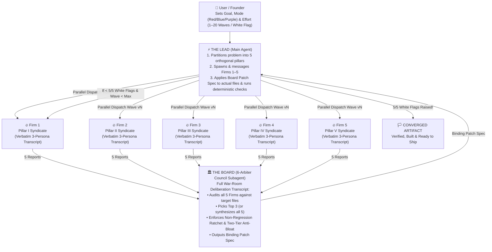

# 🏛️⚔️ THE BOARD: Universal Multi-Agent Persona-Conditioned Convergence Skill

**The Board** turns any AI coding or reasoning agent (**Claude Code, Google Antigravity, Gemini CLI, Cursor, or Codex**) into an adversarial, multi-wave war room.

Instead of asking a single polite assistant to *"review my code"* or *"improve this plan"*, **The Lead** (you, the main conversation agent) dispatches **5 parallel specialist subagents (`Firms 1–5`)** wearing hyper-specific, high-stakes **Persona Masks** who argue in **verbatim roleplayed transcripts**, followed by **The Board of Directors** who adjudicate all 5 reports, pick the **Top 3** (or synthesize all 5), enforce a strict **Non-Regression Ratchet**, and hand **The Lead** a surgical **Patch Spec** to execute across `v1 -> v2 -> ... -> vN` until all 5 firms raise the **White Flag (`🏳️ 5/5`)**.

---

## 🔌 Cross-Agent Tool Mapping (Works Everywhere)

Whether you are running inside **Google Antigravity (`agy`)**, **Claude Code (`claude`)**, **Gemini CLI (`gemini`)**, **Cursor**, or **Codex**, map the 4 core actions of **The Board** to your native runtime tools as follows:

| Board Action | Google Antigravity (`agy`) / Gemini CLI | Claude Code (`claude`) | Single-Thread / No-Subagent Fallback |
| :--- | :--- | :--- | :--- |
| **1. Spawn 5 Parallel Firms (`Wave v1`)** | Call `invoke_subagent` (`TypeName: "self"`, `Role: "Firm 1..."`) 5 times in a single turn | Call the `Task` / `Agent` tool 5 times in a single message (parallel tool calls) | Execute Firms 1–5 sequentially in-turn, writing each `vN/firmK_*.md` file before convening The Board |
| **2. Re-Challenge Firms in `Wave v2..vN`** | Call `send_message` to the **existing 5 `conversationId`s** so each Firm retains full memory of how its prior attacks were defeated | Resume the existing agent IDs (`resume` parameter) or pass the Firm's prior transcript path `v(N-1)/firmK_*.md` into a parallel `Task` call | Read `v(N-1)/firmK_*.md` and generate `vN/firmK_*.md` with explicit memory of prior defeated vectors |
| **3. Convene The Board (`Adjudication`)** | Call `invoke_subagent` (or `send_message` to the persistent Board subagent ID) to read all 5 Firm reports and write `vN/BOARD_ADJUDICATION_vN.md` | Call `Task` / `Agent` to read `vN/firm1..5_*.md` and write `vN/BOARD_ADJUDICATION_vN.md` | Write `vN/BOARD_ADJUDICATION_vN.md` after reading all 5 Firm reports |
| **4. Apply Patch Spec & Verify** | **The Lead** edits target files (`edit_file`/`write_file`) and runs compiler/tests/validators (`run_command`) | **The Lead** edits target files (`Edit`/`Write`) and runs compiler/tests/validators (`Bash`) | **The Lead** edits target files and runs verification commands |

---

## 🧠 Why Verbatim Persona Roleplay Works ("The Mask Effect")

Asking an LLM *"Find bugs in this C++ lock-free queue"* or *"Find loopholes in this patent/contract"* activates the model's average, conflict-averse assistant prior. It gives you 4 polite bullet points and stops.

When you instead forbid summary bullets and force each subagent to write a **400–800+ line verbatim war-room transcript** featuring named, ego-driven domain specialists—a `$2,400/hr` appellate litigator arguing with a Chief Controls Architect, a greybeard kernel hacker tearing apart memory-ordering barriers on a whiteboard, or a competitor CEO plotting a $50M design-around—three emergent behaviors trigger inside the transformer:

1. **Latent-Space Tail Conditioning:** High-stakes, specialist dialogue shifts token sampling out of generic tutorial prose and into the 99.9th-percentile technical/adversarial tail of the training distribution. The persona *cannot* give a lazy answer without breaking character.
2. **Intra-Agent Dialectical Verification (The 3-Persona Triad):** Every Firm is staffed with **3 contrasting personas**:
   - **Mask 1 (The Ruthless Partner / Principal Lead)** demands catastrophic, quantifiable impact (`$`, crash, SLA breach, invalidity).
   - **Mask 2 (The Code / Math / Statutory Purist)** reads every line of the target file literally and **shoots down Mask 1's lazy first instinct** when the artifact already defends against it (*"Hold on—read lines 142–158, they already guarded that mutex. Look instead at the release barrier..."*).
   - **Mask 3 (The Lateral Exploit / Design-Around Hacker)** synthesizes a deeper 2nd- or 3rd-order attack that bypasses the existing guard.
   Weak ideas get killed *inside the transcript* before they ever reach The Board.
3. **Orthogonal Coverage via 5-Pillar Partitioning:** Partitioning the target into **5 non-overlapping pillars (`Pillars I–V`)** prevents context dilution. Firm 3 only cares about Pillar III; they will dig 8 levels deep into edge cases a generalist prompt would never notice.

*(See [references/persona_mask_theory.md](./references/persona_mask_theory.md) for the complete guide to constructing adversarial persona triads.)*

---

## 🏗️ The 4-Tier Architecture

### Operating Modes
- **🔴 Red-Team Mode (`red`):** 5 hostile syndicates (exploit researchers, competitor R&D teams, or opposing litigators) try to break, exploit, or design around your code, architecture, contract, or patent across waves `v1..vN` until `5/5` raise the **White Flag**.
- **🔵 Blue-Team Tournament Mode (`blue`):** 5 elite specialist boutiques compete in a tournament to pitch the best architecture, feature design, commercial GTM, or Pentagon/DoD capture strategy. **The Board** grades all 5, crowns the **Top 3 Podium Winners**, and **The Lead** synthesizes the Top 3 (plus tactical gems from #4 & #5) into a single Master Playbook.
- **🟣 Purple-Team Hybrid Mode (`purple`):** Blue Teams build competing designs in Wave `v1`; Red Teams ruthlessly attack the unified winner in Waves `v2..vN` until `5/5` White Flags.

---

## 🎚️ The Effort Dial & White-Flag Convergence Protocol

Parse the user's desired effort level (or default to `standard` for normal tasks and `white-flag` when the user asks to iterate until unbeatable):

| Effort Level | Wave Cap (`max_waves`) | Convergence Target | Ideal Use Cases |
| :--- | :---: | :--- | :--- |
| **`strike`** | `1–2` waves (`v1–v2`) | 1st- & 2nd-order flaws eliminated; Top 3 Blue-Team designs synthesized | Fast PR reviews, bug root-cause isolation, tactical design docs |
| **`standard`** | `3–5` waves (`v1–v5`) | 3rd- & 4th-order edge cases closed; `>= 95/100` Board rating | Production code refactors, API designs, commercial/DoD GTM playbooks |
| **`deep`** | `6–10` waves (`v1–v10`) | 5th- to 10th-order paradigm shifts checkmated + Two-Tier anti-bloat pass | Lock-free/SIMD kernels, zero-day security audits, M&A/licensing contracts |
| **`relentless` / `white-flag`** | Up to `15–20+` waves (`v1–v20`) | **Unconditional `5/5` White-Flag Surrender (`0` surviving non-suicidal vectors)** | Flagship patent applications (`v1->v16`), safety-critical aerospace/crypto/medical code, company-defining architectures |

*(See [references/effort_and_white_flag.md](./references/effort_and_white_flag.md) for the Non-Regression Ratchet, Two-Tier Anti-Bloat Compression, and White-Flag verification rules.)*

---

## 🚀 Step-by-Step Execution Runbook for THE LEAD

### Phase 0: Initialize Workspace & Partition into 5 Orthogonal Pillars
1. Read the target files (source code, architecture doc, legal/patent draft, or strategy plan).
2. Create a wave tracking directory (`.board/v1/` or `<project>/red_team/v1/`, or run `python scripts/init_board_workspace.py`).
3. Partition the problem into **5 strictly orthogonal pillars (`Pillars I–V`)** so the 5 Firms never duplicate each other's work.
   - *Use [references/domain_playbooks.md](./references/domain_playbooks.md) for ready-to-deploy 5-Firm + Board persona rosters across **Software/Systems Coding**, **Cybersecurity/Zero-Day Red-Teaming**, **Legal/Patent Prosecution**, **Commercial/B2B/Pentagon Strategy**, and **PhD Algorithm/Physics/ML Research**.*

### Phase 1: Dispatch the 5 Firms in Parallel (`Wave vN`)
1. Launch **Firms 1–5 in parallel** using your platform's subagent tool (`invoke_subagent` or `Task`/`Agent`) and the prompt templates in [references/prompt_templates.md](./references/prompt_templates.md).
2. **Persistent Adversarial Memory Rule (`Wave v2..vN`):**
   - For Wave `v2` onward, **message or resume the exact same 5 subagents** (or pass their prior wave transcript) so each Firm experiences the defeat of its Wave `v(N-1)` attacks in-character and is forced to invent genuine **Nth-order paradigm-shift vectors**.
3. **Enforce the 4 Transcript Laws on Every Firm:**
   - **Law 1 (`400–800+` Lines of Verbatim Dialogue):** No polite bullet summaries. Characters must argue in-voice and cite exact file paths, line numbers, equations, or clauses.
   - **Law 2 (Internal Pushback):** Persona 2 must shoot down at least two naive ideas from Persona 1 by proving the target artifact already handles them.
   - **Law 3 (Non-Suicidal Filter):** Attacks or workarounds that destroy the attacker's own core SLA/product by >10x or violate physics/statute are disallowed.
   - **Law 4 (Earned White Flag Only):** A Firm may hoist `🏳️ STATUS: WHITE FLAG RAISED — 0 SURVIVING VECTORS` **only** after testing at least 3 new Nth-order candidate attacks in dialogue and proving all 3 are already foreclosed.

### Phase 2: Convene THE BOARD (`Adjudication, Top-3 Selection & Patch Spec`)
1. Once `vN/firm1_*.md` through `vN/firm5_*.md` are written, dispatch **The Board** subagent (`vN/BOARD_ADJUDICATION_vN.md`) using the Board template in [references/prompt_templates.md](./references/prompt_templates.md).
2. Inside its verbatim 6-Arbiter deliberation transcript, **The Board** must:
   - Cross-examine every Firm's findings against the actual target files.
   - **In Blue-Team Mode:** Score all 5 firms (`0–100`), select the **Top 3 Winning Strategies**, and extract any high-leverage gems from Firms 4 & 5.
   - **In Red-Team Mode:** Filter out false positives, enforce the **Non-Regression Ratchet** (no patch may weaken a `v1..v(N-1)` defense), apply **Two-Tier Compression** (so defenses stay modular and crisp rather than bloated), and write an exact, file-by-file **Binding Patch Spec**.

### Phase 3: THE LEAD Applies the Patch Spec & Runs Deterministic Checks
1. Read `vN/BOARD_ADJUDICATION_vN.md` and apply the Binding Patch Spec directly to the target files.
   - *Engineering Discipline:* Fix root causes, never symptoms. Preserve 100% of existing working functionality.
2. Run deterministic verification immediately after patching:
   - **Codebases:** Build, typecheck, lint, and run unit/integration/benchmark tests.
   - **Legal / Patents / Contracts:** Run term-consistency, antecedent-basis, figure/reference-numeral, and statutory compliance checks.
   - **Strategy / Plans:** Reconcile all financial tables, unit economics, and timeline dependencies.

### Phase 4: Check Convergence (`verify_convergence.py`) or Escalate to `Wave v(N+1)`
1. Inspect the Board's Convergence Scorecard (or run `python scripts/verify_convergence.py --wave-dir .board/vN`):
   - **If `< 5/5` White Flags AND `N < max_waves`:** Loop immediately to **Phase 1 (`Wave v(N+1)`)**, briefing the 5 Firms on how their `vN` attacks were just neutralized.
   - **If `5/5` Firms have raised Verified White Flags (`0` surviving vectors):**
     - Execute **Stage `v(N).5` (Empirical / Benchmark / Figure / Table Sync)** and **Stage `v(N+1)` (Final Pre-Ship Board Sign-Off)** so the finished artifact is 100% synchronized and ready to ship!

---

## 📚 Progressive Disclosure Reference Files

Load these companion files from this skill directory as needed:
- **[references/persona_mask_theory.md](./references/persona_mask_theory.md)** — Why verbatim persona transcripts unlock latent-space tail reasoning ("The Mask Effect") and how to design 3-persona Firm triads + 6-arbiter Boards.
- **[references/domain_playbooks.md](./references/domain_playbooks.md)** — Ready-to-use 5-Firm + Board rosters and orthogonal pillar partitions for **Software/Systems Coding**, **Cybersecurity/Zero-Day Red-Teaming**, **Patent/Legal Prosecution**, **Commercial/B2B/Pentagon Strategy**, and **PhD Algorithm/Physics/ML Research**.
- **[references/prompt_templates.md](./references/prompt_templates.md)** — Copy-paste dispatch prompts for Wave `v1` Red Teams, Wave `vN` Escalation (`send_message`/`resume`), Blue-Team Tournaments, and Board Adjudication.
- **[references/effort_and_white_flag.md](./references/effort_and_white_flag.md)** — The Effort Dial (`strike` to `relentless/white-flag`), Non-Regression Ratchet, Two-Tier Anti-Bloat Compression, and White-Flag verification protocol.
- **[examples/](./examples/)** — Concrete excerpts of verbatim war-room transcripts and Board Patch Specs across coding, legal/patent, and Blue-Team strategy runs.
- **[scripts/init_board_workspace.py](./scripts/init_board_workspace.py)** & **[scripts/verify_convergence.py](./scripts/verify_convergence.py)** — Optional helper scripts to scaffold `.board/v1..vN/` and deterministically verify `5/5` White-Flag convergence.
